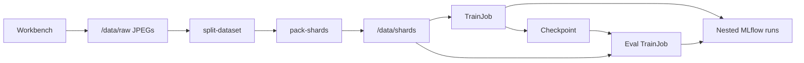

# CV shard training

A repeatable OpenShift AI 3.5 demo for a problem customers hit when training on a large set of small files. The story is an overhead image classifier with four classes: truck, boat, plane, building. The workbench draws the JPEGs. A pipeline packs them into WebDataset shards, trains ResNet18 on two GPUs, and scores the held-out set. MLflow keeps the epoch scores, a confusion matrix, and GPU utilization.

Many small files make the GPUs wait. Each training step then pays for a separate open, read, and close. This demo does that work once, while packing, and the training loop reads large shard files instead. On a two-GPU sandbox the training rate stayed near 1,800 images per second from 20,000 images to 1,000,000.

Start with the 20,000-image path below. It is the same code as the million-image path. [scaling-to-one-million.md](scaling-to-one-million.md) is the longer run: how to draw the million images, where they land, and how long each stage took on this setup.

## Architecture

The workbench draws images onto a shared volume. The pipeline never draws, and it does not hold the GPUs. Each training step submits a Kubeflow Trainer v2 TrainJob and waits. Two nodes, one GPU each, run `train.py` with torchrun. Rank 0 writes the checkpoint and a JSON report. The pipeline task reads that JSON and publishes metrics.



MLflow creates one nested run per pipeline step. The parent run stays empty. Open the nested `train` run and the nested `evaluate` run.

The training pods do not call MLflow. They have the GPUs and no MLflow credentials. `gpu_sample.py` appends `nvidia-smi` samples on those pods. After the TrainJob finishes, the pipeline task logs them on the nested run under the `system/` names MLflow shows as System metrics.

## What you install, and what this repo adds

You bring the platform. Nothing in this repo installs OpenShift, the OpenShift AI operator, the MLflow operator, the GPU operator, a storage class, or a Trainer runtime.

The manifests add only the project resources for the demo:

| Manifest | What it creates |
| --- | --- |
| `manifests/namespace.yaml` | Project `cv-shard-training`, visible on the dashboard |
| `manifests/pvc.yaml` | Workbench home volume and the shared data volume |
| `manifests/workbench.yaml` | Jupyter workbench on the PyTorch 3.5 image |
| `manifests/workflow-controller-config.yaml` | Pipeline artifact store and the CA the workflow controller trusts |
| `manifests/dspa.yaml` | Pipeline server: API, MariaDB, and the workflow controller |
| `manifests/pipeline-rbac.yaml` | Lets the workbench start runs, and lets the pipeline create TrainJobs |

After the pipeline server is up, turn on **Allow pipeline tasks to log directly to MLflow** in the dashboard. That checkbox is not in the manifest. On a server that is already running, do not full-apply `dspa.yaml`. The file is the starting spec, and a live server may have gained fields since.

## Prerequisites

OpenShift AI 3.5, with a cluster admin having already enabled:

- The MLflow operator and an `mlflow` custom resource. A small server uses SQLite and a volume for artifacts. [Install and configure MLflow](https://docs.redhat.com/en/documentation/red_hat_openshift_ai_self-managed/3.5/html/working_with_mlflow/installing-mlflow_mlflow).
- Data science pipelines, so the project can own a pipeline server.
- A Kubeflow Trainer v2 cluster runtime named `torch-distributed-cuda130-torch211-py312`. [Run TrainJobs](https://docs.redhat.com/en/documentation/red_hat_openshift_ai_self-managed/3.5/html/working_with_distributed_workloads/running-kubeflow-trainerv2_distributed-workloads).
- Two GPU nodes. The TrainJob asks for one GPU on each of two nodes.
- An RWX storage class for the shared data volume, and an RWO class for the workbench disk and the pipeline database. The manifests use `efs-csi` and `gp3-csi`.
- A hardware profile for the workbench. The manifest selects `large-cpu-profile` in `redhat-ods-applications`.
- An S3 bucket for pipeline artifacts, and keys you can put in a secret. The bucket is separate from the MLflow artifact store.

You also need `oc` logged into the cluster, and permission to create the project.

The demo does not use MaaS or Kueue. The checkpoint stays on the shared volume.

## Configuration

Values in the repo match one sandbox. Change them before applying the manifests on another cluster. Names that include the project, such as the notebook base URL and `PIPELINE_HOST`, have to move together.

| Setting | Change it in | Sandbox value | On another cluster |
| --- | --- | --- | --- |
| Project | every manifest, and `pipeline.py` `NAMESPACE` | `cv-shard-training` | Your project name |
| Shared data volume | `manifests/pvc.yaml` `cv-data` | `efs-csi`, 100Gi, ReadWriteMany | Your RWX class. 100Gi holds the million-image set |
| Workbench disk | `manifests/pvc.yaml` `cv-workbench` | `gp3-csi`, 20Gi | Your RWO class |
| Pipeline database | `manifests/dspa.yaml` | `gp3-csi`, 10Gi MariaDB | Your RWO class |
| S3 bucket, region, host | `manifests/dspa.yaml` and `manifests/workflow-controller-config.yaml` | `cv-shard-pipelines-9j696` in `us-east-2` | Your bucket |
| S3 keys | secret `aws-s3-pipelines` | not in git | `AWS_ACCESS_KEY_ID`, `AWS_SECRET_ACCESS_KEY` |
| Dashboard host | `pipeline.py` `DASHBOARD`, `manifests/workbench.yaml` `MLFLOW_TRACKING_URI` | `rh-ai.apps.ocp.9j696.sandbox5421.opentlc.com` | Your OpenShift AI route |
| Pipeline API | `pipeline.py` `PIPELINE_HOST` | `ds-pipeline-dspa.cv-shard-training.svc.cluster.local:8443` | Same service name in your project |
| Workbench image and size | `manifests/workbench.yaml` | PyTorch 3.5, 2 CPU, 8Gi | Keep a 3.5 image that includes PyTorch and MLflow |
| Trainer runtime | `submit_trainjob.py` `RUNTIME` | `torch-distributed-cuda130-torch211-py312` | A CUDA TrainJob runtime that exists on the cluster |
| GPUs | `submit_trainjob.py` `build_train_job` | 2 nodes, 1 GPU, 4 CPU, 24Gi each | Match the nodes you have |
| Pipeline task image | `pipeline.py` `BASE_IMAGE` | `s2i-generic-data-science-notebook:3.5` | The 3.5 data science notebook image |
| Pipeline version | `pipeline.py` `VERSION_NAME` | `v2` | A new name each time the graph changes. Versions are immutable |

`pipeline.py` uses `verify_ssl=False` when it talks to the in-cluster pipeline API from the workbench. The workflow controller still needs the cluster CA, which is `SSL_CERT_FILE=/kfp/certs/ca.crt` in the workflow ConfigMap. Apply that ConfigMap before `dspa.yaml`. Leave the generated ConfigMap `ds-pipeline-workflow-controller-dspa` alone. The operator replaces it.

Training knobs you can change without editing manifests:

| Knob | Default | Where |
| --- | --- | --- |
| Images | 20,000 in the notebook. `0` in the pipeline means every JPEG under the raw directory | `demo.ipynb`, `pipeline.py --max-per-class` |
| Classes and image size | four classes, 256×256 JPEG | `generate_images.py` |
| Split | 80/20, seed 17 | `split_dataset.py` |
| Images per shard | 2,000 | `pack_shards.py` |
| Epochs | 1 | `pipeline.py --epochs` |
| Batch, workers, learning rate | 128, 2 workers per GPU, 0.05 | `train.py` |
| Model | ResNet18 from scratch | `train.py` |
| Train wait | 3,600 seconds | `submit_trainjob.py` `TIMEOUT_SEC` |

Shard shuffle stays off so both ranks see the same shard list. `split_by_node` divides that list across the two GPUs.

## Dependencies the demo installs

The workbench image already has Python 3.12, PyTorch, Pillow, NumPy, matplotlib, and MLflow. The pipeline task image has MLflow and matplotlib. The Trainer image has CUDA, PyTorch, and `nvidia-smi`.

You install two things the images do not carry:

| Package | When | Pin |
| --- | --- | --- |
| `kfp` | Last cell of `demo.ipynb`, from PyPI | `2.17.0` |
| `webdataset` and `braceexpand` | Once, onto the shared volume at `/data/pydeps` | `webdataset==0.2.100` |

The TrainJob imports WebDataset from `/data/pydeps`. It does not use the workbench site-packages.

## Run the 20,000-image demo

1. Create the artifact secret in the project. Do not commit it.

   ```bash
   oc create secret generic aws-s3-pipelines \
     --from-literal=AWS_ACCESS_KEY_ID=YOUR_KEY \
     --from-literal=AWS_SECRET_ACCESS_KEY=YOUR_SECRET \
     -n cv-shard-training
   ```

2. Apply the manifests in order.

   ```bash
   oc apply -f manifests/namespace.yaml
   oc apply -f manifests/pvc.yaml
   oc apply -f manifests/workbench.yaml
   oc apply -f manifests/workflow-controller-config.yaml
   oc apply -f manifests/dspa.yaml
   oc apply -f manifests/pipeline-rbac.yaml
   ```

3. Wait until the workbench and the pipeline server are ready. In the dashboard open the project, then **Manage pipeline server → Advanced settings**, and turn on **Allow pipeline tasks to log directly to MLflow**.
4. Open the workbench **CV shard training**. Clone this repo into `/opt/app-root/src`. The shared volume is `/opt/app-root/src/data` there, and `/data` on the pipeline and training pods.
5. Copy the scripts the pods run, and install WebDataset. Editing the git checkout is not enough. The pods read `/data/code`.

   ```bash
   mkdir -p /opt/app-root/src/data/code
   cp split_dataset.py pack_shards.py train.py submit_trainjob.py gpu_sample.py torchrun.sh \
     /opt/app-root/src/data/code/
   pip install --index-url https://pypi.org/simple \
     --target /opt/app-root/src/data/pydeps --no-deps \
     webdataset==0.2.100 braceexpand
   ```

6. Run `demo.ipynb` from the top.
   - The first cell draws 20,000 JPEGs, 5,000 of each class, under `/opt/app-root/src/data/raw`. With one worker on this workbench that takes a few minutes. The generator stamp is `overhead-silhouettes-v1`. A later run with the same stamp fills gaps. If the folder already has more images than you asked for, the cell stops. Pass `--replace` only when you mean to delete the extras.
   - The next cell shows a 4×4 preview.
   - The last cell installs `kfp` and starts the pipeline. Defaults: every image currently in `/data/raw`, one epoch, shards in `/data/shards`, metrics in `/data/metrics`, checkpoint `/data/models/resnet18.pt`.

7. Open **Develop and train → Pipelines**. The run is `overhead-shard-training`, version `v2`, with steps `split-dataset`, `pack-shards`, `train`, and `evaluate`. On this setup a 20,000-image, one-epoch run finishes in well under half an hour. Most of that is scheduling the two GPU pods. The fit itself is under a minute.
8. Open **Develop and train → Experiments (MLflow)** and the experiment `overhead-shard-training`. Read the nested train run and the nested evaluate run.

Pack deletes existing `shard-*.tar` files inside `<shard_dir>/train` and `<shard_dir>/test` before it writes new ones. A trial that must leave the main shards alone uses its own directories. `pipeline.py` refuses a subset that still points at `/data/shards`, `/data/metrics`, or the default checkpoint.

```bash
python pipeline.py \
  --max-per-class 5000 \
  --epochs 3 \
  --shard-dir /data/subset-20k/shards \
  --metrics-dir /data/subset-20k/metrics \
  --checkpoint /data/subset-20k/models/resnet18.pt
```

`--max-per-class 5000` keeps the first 5,000 JPEGs of each class, which is 20,000 images. `--max-per-class 0` uses every JPEG in the raw directory.

## Where the files go

Paths below are what the pipeline and the TrainJobs see. In the workbench, prefix them with `/opt/app-root/src`.

| Path | Contents |
| --- | --- |
| `/data/raw/<class>/000000.jpg` | Generated JPEGs. Also `classes.txt` and `generator.txt` |
| `/data/splits/split.json` | The 80/20 list. A custom shard dir uses `<shard_dir>/../splits/split.json` |
| `/data/shards/train`, `/data/shards/test` | WebDataset tarballs, 2,000 images each, plus `manifest.json` |
| `/data/metrics/train-metrics.json` | Epoch history, confusion counts, images per second |
| `/data/metrics/test-metrics.json` | Held-out scores and the confusion matrix |
| `/data/models/resnet18.pt` | Checkpoint written by rank 0 |
| `/data/code` | The copies of the scripts the pods execute |
| `/data/pydeps` | WebDataset |

A 20,000-image corpus is about 205MB of JPEGs and about 196MB of shards. A million images, shards included, is about 20GB. The 100Gi shared volume has room for that.

## What a successful run shows

The train curve is the training set, one point per epoch. The confusion matrix and the `test_*` scores are the held-out 20 percent. Matrix rows are the true class and columns are the predicted class, in the order truck, boat, plane, building.

| Step | Metrics |
| --- | --- |
| `split-dataset` | `train_count`, `test_count` |
| `pack-shards` | `image_count`, `train_shards`, `test_shards` |
| `train` | `loss`, `train_accuracy`, macro and per-class precision, recall, and F1, once per epoch. `images_per_sec` covers the whole fit. System metrics: `system/node_<n>/gpu_<i>_utilization_percentage` and `system/node_<n>/gpu_<i>_memory_usage_megabytes` |
| `evaluate` | `test_loss`, `test_accuracy`, `test_images`, macro and weighted precision, recall, and F1, per-class scores and support, and one `test_cm_<true>_<predicted>` count per cell. Also `confusion_matrix.png`, `.json`, and `.txt` |

The platform copies ordinary `metrics.log_metric` scalars even when the MLflow checkbox is off. The epoch curve, the matrix image, and the GPU series need the checkbox. The task logs into the run the driver already created. It does not call `mlflow.start_run()`.

On a two-GPU check with 20,000 images and three epochs, one GPU reached 99 percent utilization and the other 82 percent, both holding about 7,043 MB. A one-epoch pass on 20,000 easy drawings lands near 0.77 train accuracy and 0.83 test accuracy. More epochs on the same drawings climb toward 1.0. That score is the synthetic shapes, not a leaked split.

GPU samples arrive every 15 seconds. An eval job shorter than that interval often keeps only the startup sample. A missing `nvidia-smi`, or a failed write of the GPU series or the matrix image, is printed and does not fail the step.

## One million images

Draw the corpus yourself. It is not in the git repo, and a fresh cluster does not have it.

On the workbench, with 2 CPUs and 2 worker processes, drawing runs at about 70 images a second onto the shared volume. Pillow does the drawing, so a GPU does not speed it up. One million images is about four hours. Twenty thousand images at that rate is about five minutes. Leave the workbench at 2 CPU unless you have measured a larger size. Generation writes:

```text
/opt/app-root/src/data/raw/{truck,boat,plane,building}/000000.jpg
```

That is 250,000 files per class. The same files are `/data/raw` for the pipeline.

```bash
python -u generate_images.py --count 1000000 --workers 2 \
  --output /opt/app-root/src/data/raw
```

`run-million.sh` runs that command and then starts the pipeline at the default of one epoch. The comparison we measured used ten epochs. Raise `TIMEOUT_SEC` in `submit_trainjob.py` to at least 10800 before that fit, copy the file to `/data/code`, and start the run with `--epochs 10`. The default wait of one hour is shorter than the ten-epoch fit.

Measured on this two-GPU sandbox, after the JPEGs were already drawn:

| Stage | Time |
| --- | --- |
| Split | about 2 minutes |
| Pack one million JPEGs into 400 train shards and 100 test shards | 2 hours 15 minutes |
| Train, 10 epochs, 800,000 images per epoch | 75 minutes, about 1,800 images per second |
| Evaluate 200,000 images | about 2 minutes |

Plan on an afternoon for drawing and another afternoon for pack plus training, or leave the chain overnight. GPU utilization across that 75-minute fit sat at a median of about 91 percent and 86 percent, with memory near 7,042 MB. The same images per second as the 20,000-image run is the result to show: once the bytes are in shards, a million files does not slow the fit down. The expensive part was reading each JPEG during pack, while the GPUs were idle.

Full commands, the ten-epoch accuracy, and a 100,000-image trial are in [scaling-to-one-million.md](scaling-to-one-million.md).

## Repository layout

| Path | Purpose |
| --- | --- |
| `demo.ipynb` | Draw 20,000 images, preview them, start the default pipeline |
| `generate_images.py` | Draw the labeled JPEGs |
| `split_dataset.py` | Stratified 80/20 split |
| `pack_shards.py` | Pack the split into train and test shards |
| `train.py` | Train or evaluate ResNet18 |
| `submit_trainjob.py` | Create a TrainJob, wait, and log GPU samples |
| `gpu_sample.py` | Sample `nvidia-smi` until the training pod exits |
| `torchrun.sh` | Start `train.py` with the Trainer runtime's `PET_*` environment |
| `pipeline.py` | Register the pipeline, if needed, and start a run |
| `run-million.sh` | Draw 1,000,000 images, then start a one-epoch pipeline run |
| `tests/test_handoff.py` | Shrink-guard and metric-name checks. No cluster and no GPU |
| `scaling-to-one-million.md` | Draw and train the million-image corpus |
| `manifests/` | Project, volumes, workbench, pipeline server, and TrainJob RBAC |

```bash
python -m unittest tests.test_handoff
```

## For the next person who changes it

Copy any script you edit into `/data/code` before the next run. Pipeline version `v2` is already the graph in this repo. A change to the component code in `pipeline.py` needs a new `VERSION_NAME`, because the server will not replace a version. A change only to the scripts on the volume does not.

Compare runs in **Develop and train → Experiments (MLflow)**. The dashboard view is read-only. [Track and compare experiments](https://docs.redhat.com/en/documentation/red_hat_openshift_ai_self-managed/3.5/html/working_with_mlflow/track-and-compare-mlflow-experiments_mlflow).
